# 💳 Credit Scoring System

An end-to-end credit scorecard built on **LendingClub loans issued 2012–2016**.
Raw Kaggle data → cleaned features → WOE / Information Value analysis → logistic-regression
scorecard (300–850 points) → out-of-time evaluation → interactive Streamlit demo.

## Screenshots

> Images are generated from your own run: see [Generate the screenshots](#generate-the-screenshots).

### Executive Overview
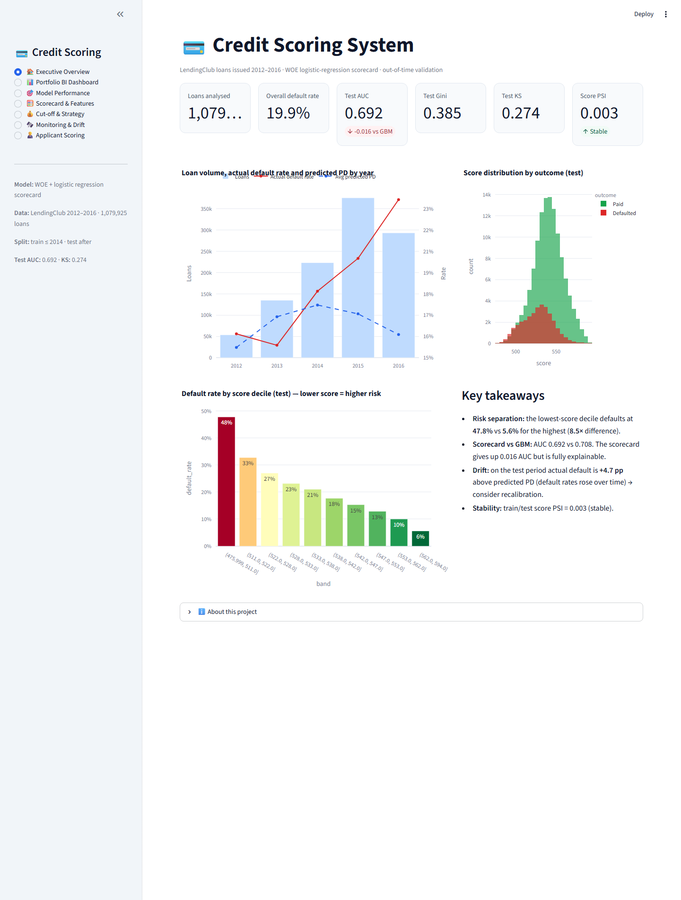

### Portfolio BI Dashboard
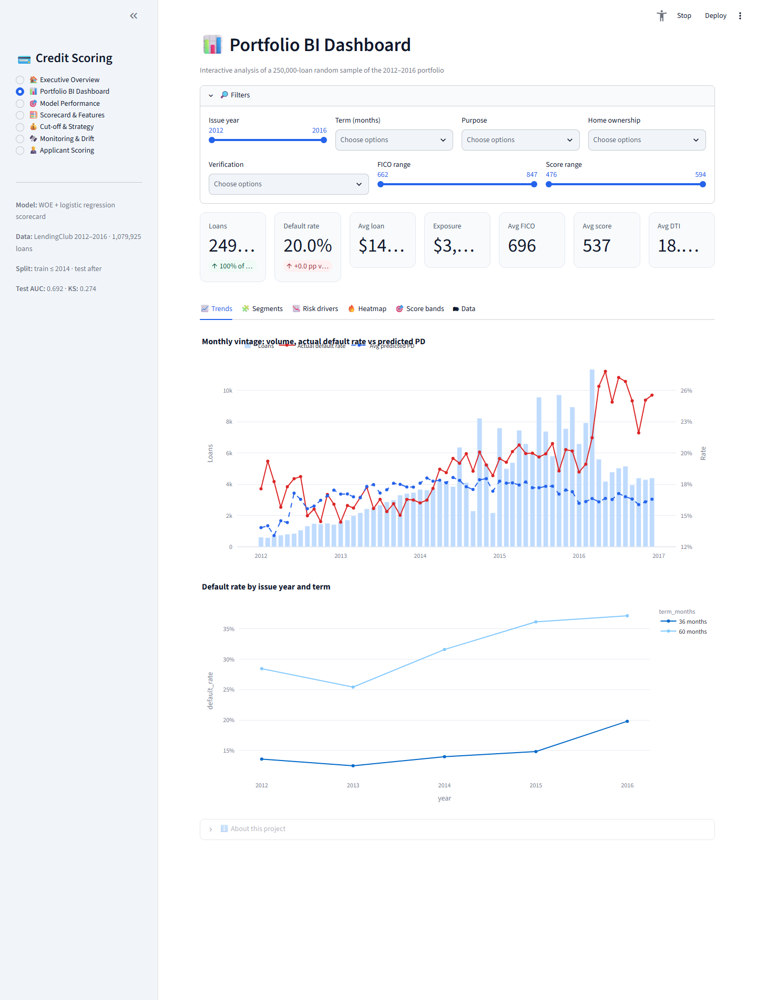

<p>
  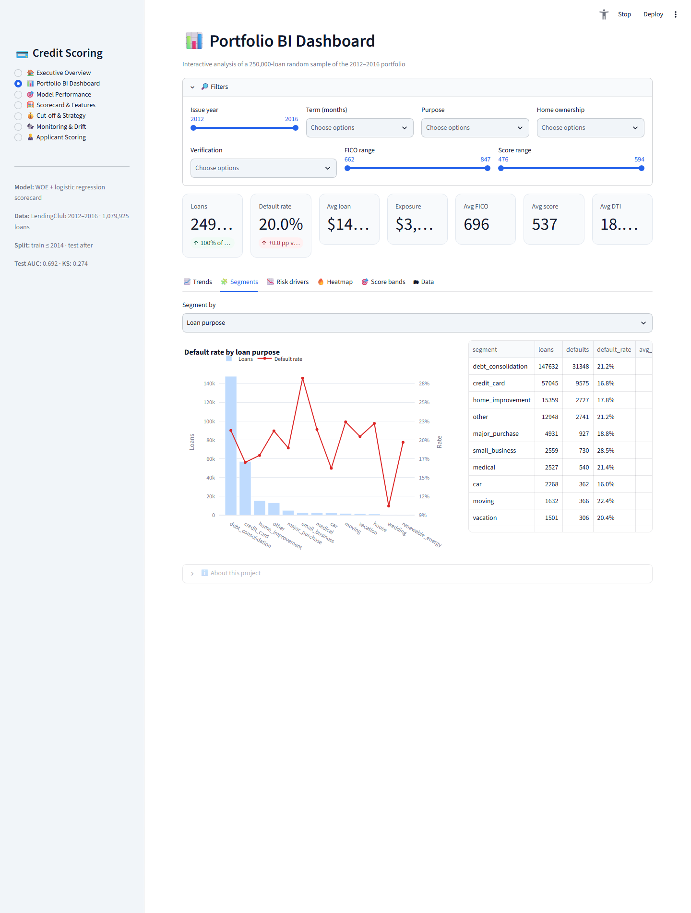
  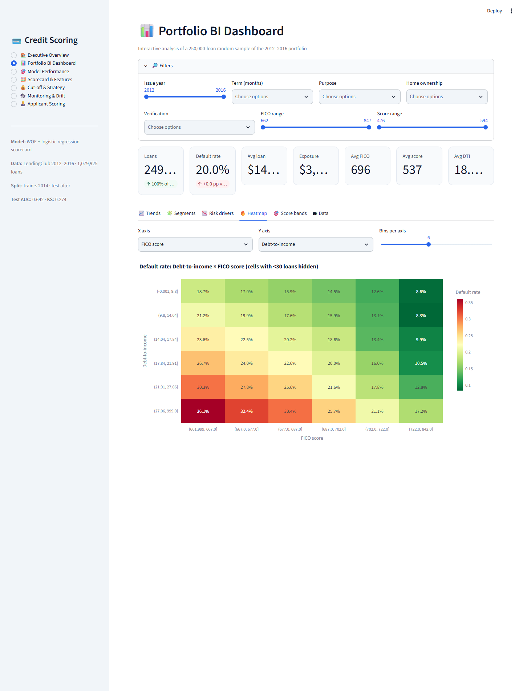
</p>

### Model Performance
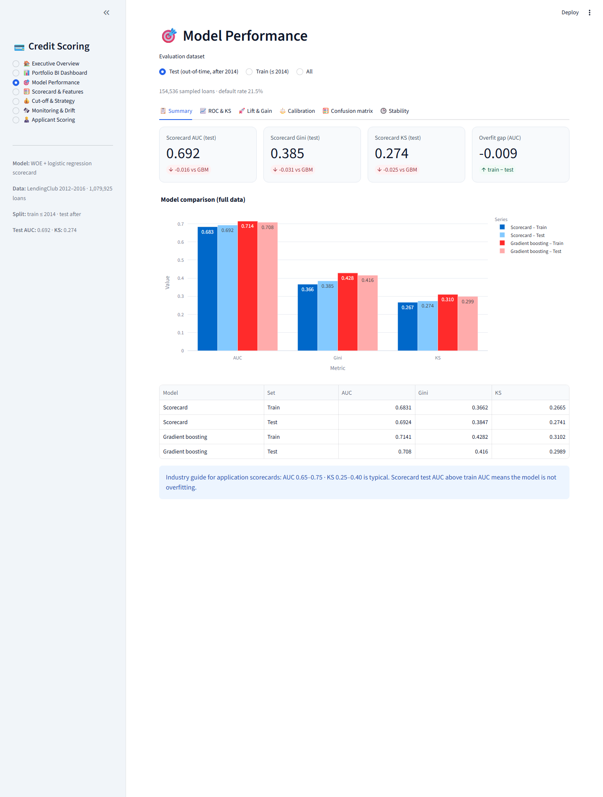

<p>
  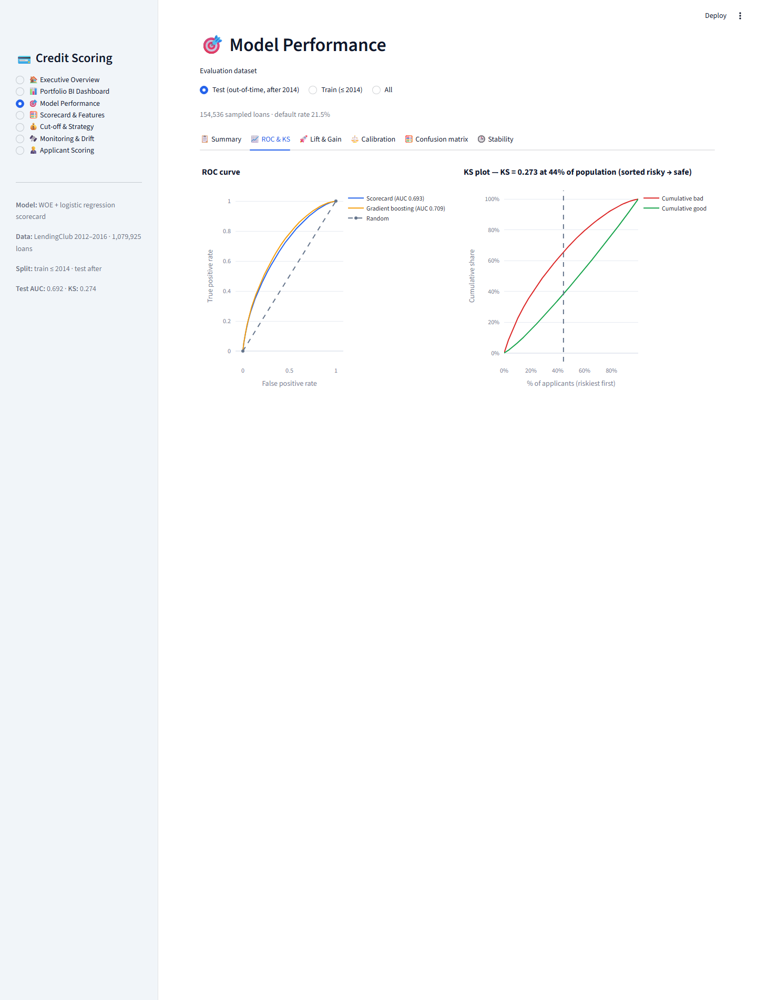
  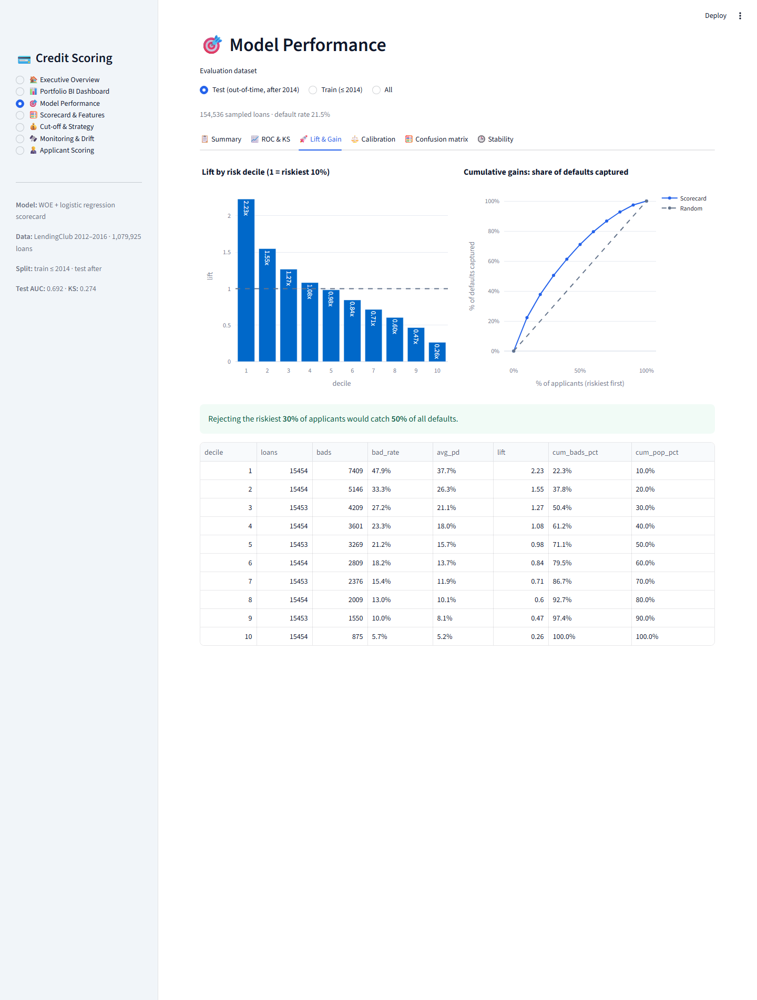
</p>
<p>
  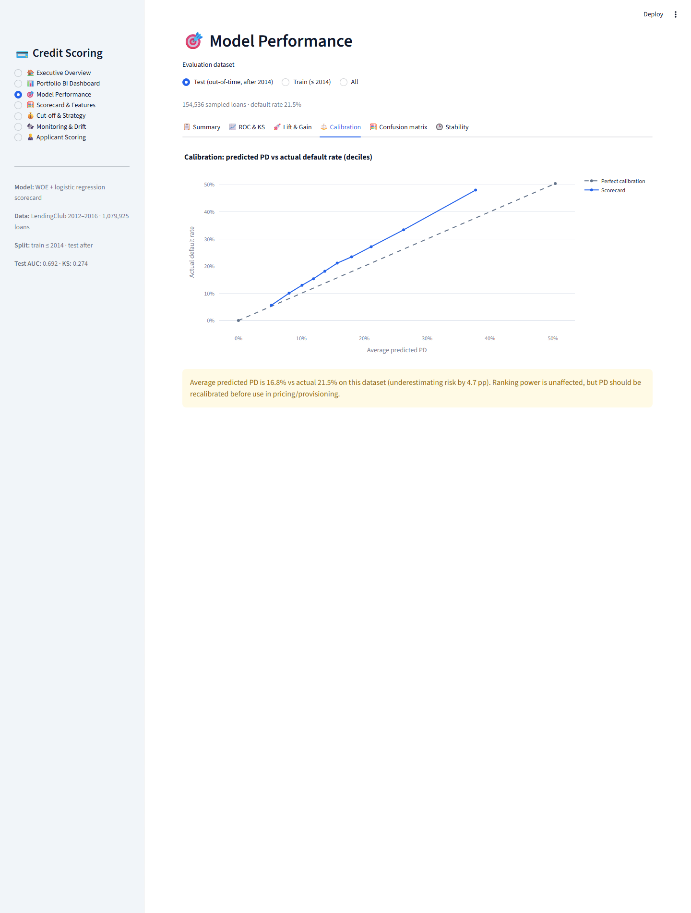
  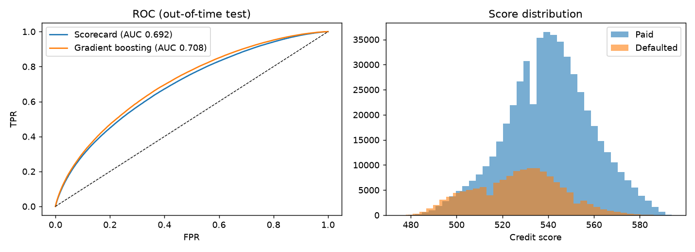
</p>

### Scorecard & Features
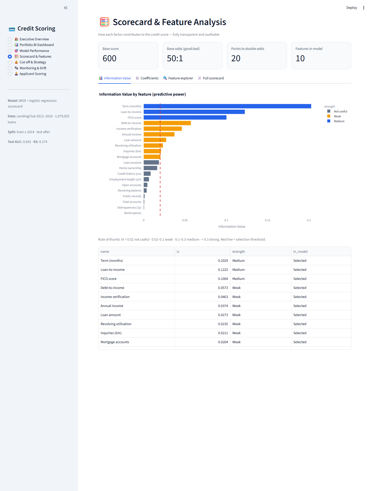

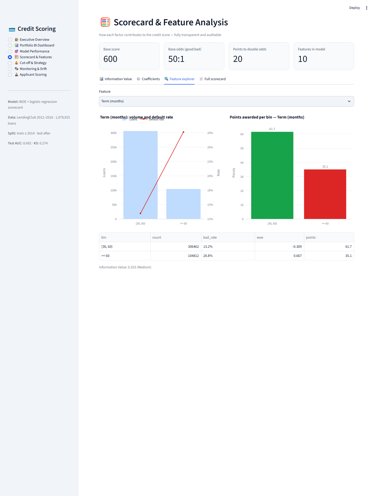

### Cut-off & Strategy
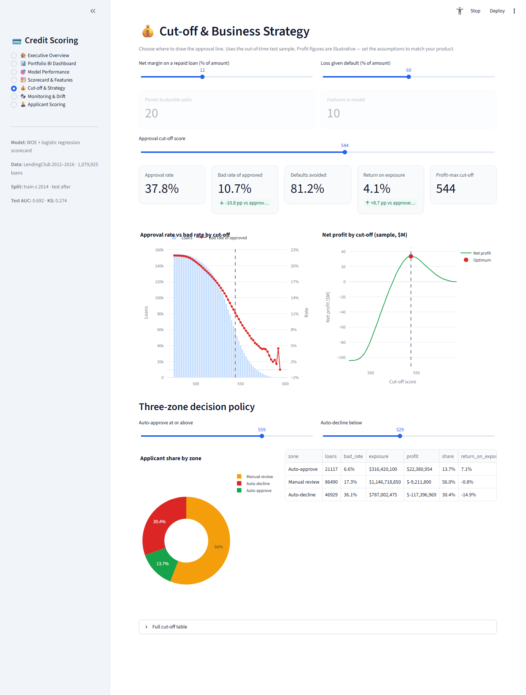

### Monitoring & Drift
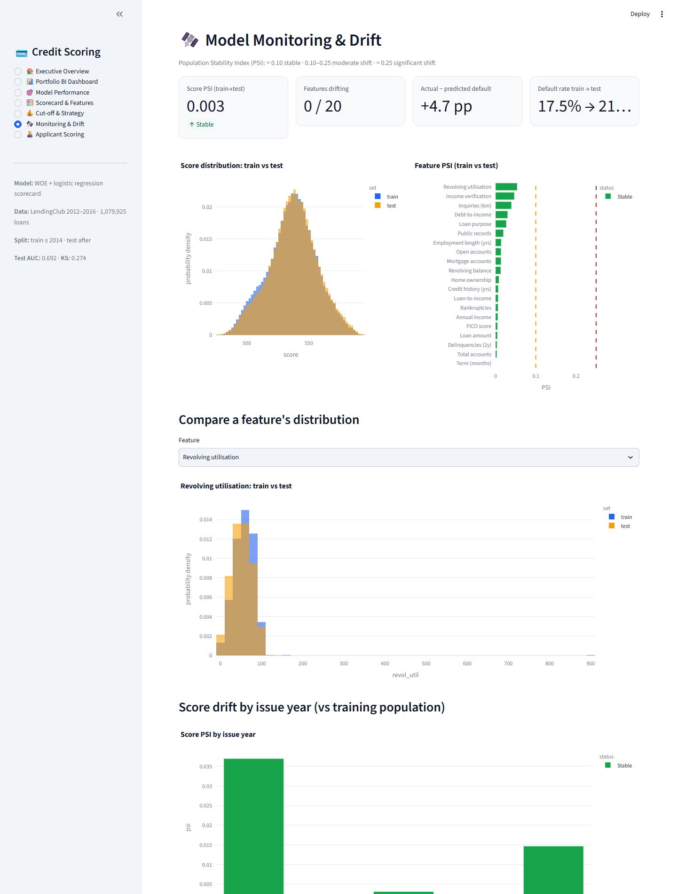

### Applicant Scoring
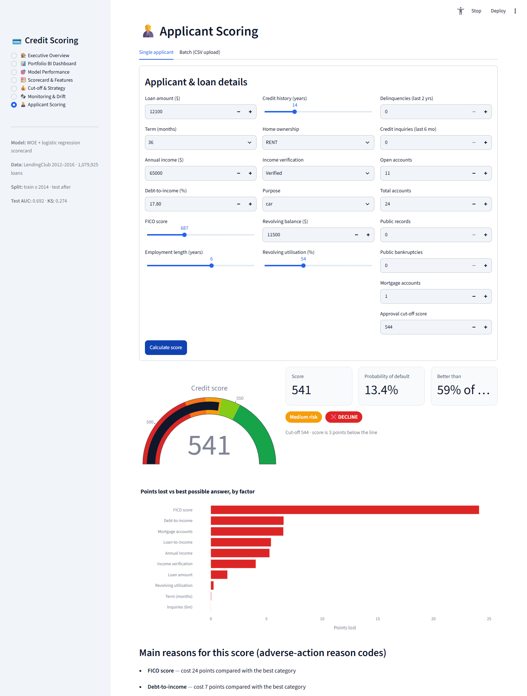

### Generate the screenshots
```bash
pip install playwright
python -m playwright install chromium
python scripts/capture_screenshots.py     # saves PNGs to docs/images/
```
The script starts the app, opens each page and tab, and saves the pictures. Run `python -m src.train` first.

## Results (out-of-time test: loans issued 2015–2016)

| Model | AUC | Gini | KS |
|---|---|---|---|
| **Scorecard (WOE + logistic regression)** | **0.692** | **0.385** | **0.274** |
| Gradient boosting (benchmark) | 0.708 | 0.416 | 0.299 |

- Train AUC 0.683 vs test AUC 0.692 → no overfitting.
- Score PSI (train vs test) = 0.003 → stable applicant population.
- The scorecard loses only ~0.016 AUC versus gradient boosting while staying fully explainable.

**Dataset:** 1,079,925 resolved loans (Fully Paid or Charged Off/Default)

| Issue year | Loans | Default rate |
|---|---|---|
| 2012 | 53,367 | 16.2% |
| 2013 | 134,804 | 15.6% |
| 2014 | 223,103 | 18.4% |
| 2015 | 375,546 | 20.2% |
| 2016 | 293,105 | 23.3% |

Train = 411,274 loans (≤ 2014) · Test = 668,651 loans (2015–2016)

**Features selected by Information Value (≥ 0.02):**
`term_months`, `loan_to_income`, `fico_avg`, `dti`, `verification_status`,
`annual_inc`, `loan_amnt`, `revol_util`, `inq_last_6mths`, `mort_acc`

**Score bands on the test set** (score ranks risk well):

| Score band | Actual default rate |
|---|---|
| 475 – 511 | 47.6% |
| 511 – 522 | 33.2% |
| 522 – 528 | 27.2% |
| 528 – 533 | 23.3% |
| 533 – 538 | 20.5% |
| 538 – 542 | 17.9% |
| 542 – 547 | 15.3% |
| 547 – 553 | 13.0% |
| 553 – 562 | 10.2% |
| 562 – 594 | 5.9% |

## Project structure
```
credit_scoring_system/
├── app.py                    # single-file Streamlit dashboard (7 pages)
├── requirements.txt
├── .streamlit/config.toml    # theme
├── scripts/
│   └── capture_screenshots.py  # creates docs/images/*.png for this README
├── docs/images/              # screenshots (generated)
├── src/
│   ├── config.py             # all settings (years, features, scaling)
│   ├── data_prep.py          # load, filter, target, feature engineering
│   ├── scorecard.py          # WoeBinner + Scorecard classes
│   ├── analytics.py          # ROC/KS/lift/PSI/profit calculations (used by train.py)
│   └── train.py              # training, evaluation, dashboard exports
├── data/raw/                 # put the Kaggle file here
├── data/processed/           # cleaned dataset (generated)
├── models/                   # scorecard.joblib (generated)
└── reports/                  # metrics, tables, scored sample (generated)
```

## Dashboard pages
| Page | What it shows |
|---|---|
| 🏠 Executive Overview | KPI cards, volume vs actual default vs predicted PD by year, score distribution, decile default rates, auto-generated takeaways |
| 📊 Portfolio BI Dashboard | Filters (year, term, purpose, home, verification, FICO, score) → KPIs, monthly vintages, segment analysis, risk-driver bands (FICO, DTI, income, utilisation…), two-variable default-rate heatmap, score bands, data export |
| 🎯 Model Performance | Scorecard vs gradient boosting, ROC, KS plot, lift & cumulative gains, calibration, confusion matrix with threshold slider, AUC and PD stability by year (train / test / all) |
| 🧮 Scorecard & Features | Information Value chart, coefficients, per-feature WOE/points explorer, full scorecard download |
| 💰 Cut-off & Strategy | Approval rate vs bad rate, profit curve with optimum, 3-zone policy (approve / review / decline) with editable margin and LGD assumptions |
| 🛰️ Monitoring & Drift | Score PSI, feature PSI, train vs test distributions, drift by year, recalibration advice |
| 🧑‍💼 Applicant Scoring | Score gauge, PD, percentile, decision, reason codes; batch scoring from a CSV with downloadable results |

## Setup & run
```bash
pip install -r requirements.txt
```
1. Download **LendingClub Loan Data** from Kaggle (`wordsforthewise/lending-club`) and place
   `accepted_2007_to_2018Q4.csv.gz` in `data/raw/` (no need to unzip).
2. Run the pipeline (re-run `python -m src.train` after pulling this version so the dashboard data is created):
```bash
python -m src.data_prep      # keeps 2012-2016 resolved loans -> data/processed/
python -m src.train          # trains, evaluates, writes models/, reports/ and dashboard data
python -m streamlit run app.py   # full dashboard
```

## Method
| Step | Detail |
|---|---|
| Population | Loans issued 2012–2016 with a final outcome. Current / late loans are excluded. |
| Target | `default = 1` if Charged Off or Default, else 0 |
| Leakage control | `int_rate`, `grade`, `sub_grade`, `installment` and all post-issue payment columns are dropped (they are LendingClub's own risk judgement or only known after the loan) |
| Features | Income, DTI, FICO, revolving utilisation, credit history length, delinquencies, inquiries, employment length, loan-to-income, home ownership, purpose, etc. |
| Binning | Quantile bins for numeric features; categories for text features (rare → "Other", missing → own bin) |
| Weight of Evidence | `WOE = ln(%bad / %good)` per bin; Information Value used for feature selection (IV ≥ 0.02) |
| Model | Logistic regression on WOE values |
| Scaling | `Score = Offset − Factor × ln(odds)`; 600 pts at 50:1 good:bad, +20 pts (PDO) doubles the odds; clipped to 300–850 |
| Validation | Out-of-time split (train ≤ 2014, test 2015–2016); AUC, Gini, KS, PSI |
| Benchmark | `HistGradientBoostingClassifier` on the same features |

## Output files (`reports/`)
| File | Content |
|---|---|
| `metrics.json` | AUC / Gini / KS / PSI for all models |
| `iv_table.csv` | Information Value of every feature |
| `scorecard_table.csv` | Points awarded per feature bin (the scorecard itself) |
| `score_bands.csv` | Actual vs predicted default rate by score decile |
| `cutoff_analysis.csv` | Approval rate vs bad rate for each cut-off score |
| `evaluation.png` | ROC curves and score distribution |
| `scored_sample.csv.gz` | 250k scored loans (train + test) that power the dashboards |
| `yearly_summary.csv` | Volume, default rate, avg PD and AUC per issue year |

## Key findings & limitations
1. **Population drift.** Default rates rose from ~16% (2012–13) to ~23% (2016). A model trained on ≤ 2014
   therefore *underestimates* PD on later loans (e.g. worst band: predicted 37.6% vs actual 47.6%).
   Ranking power (AUC/KS) is intact, but probabilities would need recalibration for production use.
2. **Score range is compressed (~475–594).** The scaling assumes 50:1 odds, but the real good:bad odds in this
   data are around 4:1. This only affects presentation, not ranking. Tune `BASE_ODDS` / `PDO` in `config.py`.
3. **No reject inference.** Only approved loans are in the data, so the model never sees rejected applicants
   (selection bias).
4. **Maturity bias.** 2015–2016 loans that have already finished skew toward early defaults.
5. **Fairness & compliance** (adverse-action reasons, bias testing) are out of scope, although
   `Scorecard.explain()` shows the points behind each individual decision.

## Possible improvements
- Recalibrate predicted PD to the most recent period (e.g. Platt / isotonic calibration)
- Train on 2012–2015 and test on 2016 to reduce drift (`TRAIN_END_YEAR = 2015`)
- Monotonic binning, SHAP explanations for the gradient-boosting benchmark
- Add a profit-based cut-off analysis (expected loss vs interest income)
